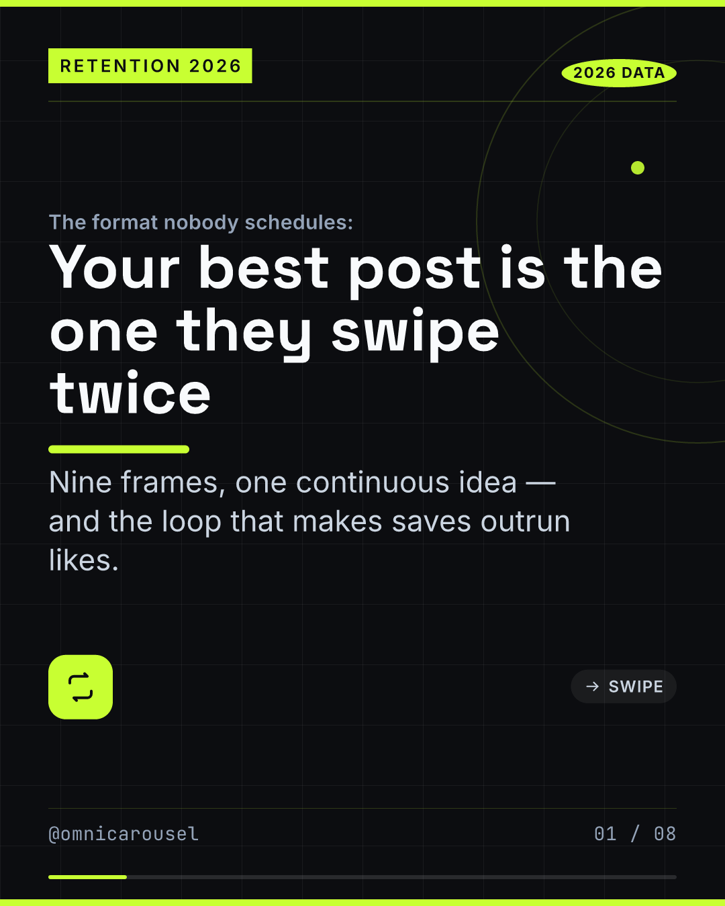
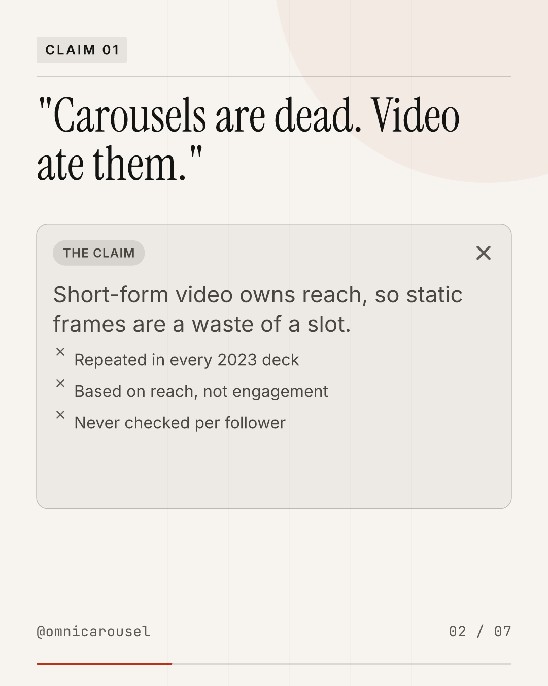
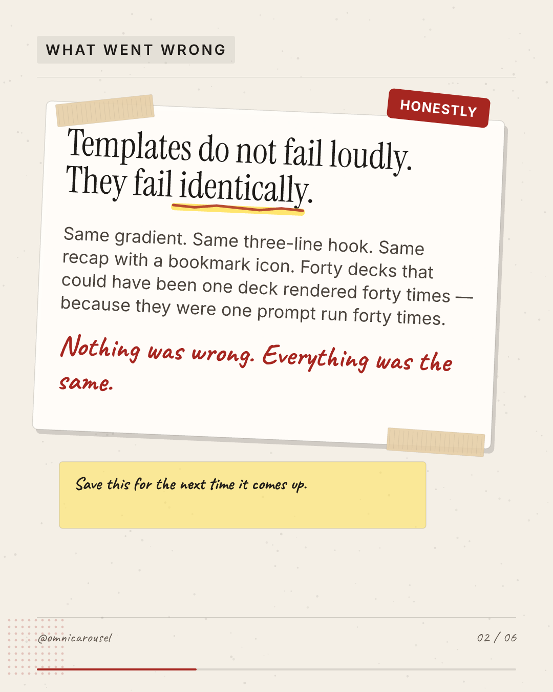

# omni-carousel-agent

**Turn a topic into a publish-ready carousel — 1080×1350 Instagram slides, a multi-page LinkedIn PDF, seamless panorama spans, and a caption — from any AI agent, with no browser, no API keys, and no design step.**

One deterministic engine. Nine tools. Thirteen host integrations. Four themes. Eleven layouts.

[](../../actions/workflows/ci.yml)
[](../../actions/workflows/mcp-conformance.yml)
[](LICENSE)

<p align="center">
  
  
  
</p>

<p align="center"><sub>Rendered by this repo — no Figma, no browser, ~1.8 s for an eight-slide deck.</sub></p>

<p align="center">
  <a href="examples/rendered/index.html"><b>▸ Open the gallery</b></a> — 8 decks, 59 slides, every artefact one click away.
  <br /><sub><code>npm run serve-gallery</code> then visit <code>localhost:4173</code></sub>
</p>

---

## Why this exists

Most "AI carousel" tools generate an image and hope. This one treats a carousel as a **typed document**: a `CarouselSpec` is validated against the same rules the platform rewards, then rendered by a layout engine that cannot produce off-brand, mis-aligned, or unreadable output.

- **The model writes content, the engine owns the pixels.** Copy budgets, contrast, margins and typography are enforced by code, not by prompt luck.
- **Deterministic.** Same spec in, same bytes out. No random seeds, no browser renderer in the default path, bundled OFL fonts.
- **Agent-native.** Model Context Protocol tools, resources and a prompt — plus first-class SDKs for Anthropic, OpenAI and the Vercel AI SDK.
- **Researched, not vibed.** The rules come from a written corpus in [`docs/research/`](docs/research/) — 2026 Instagram and LinkedIn benchmarks, retention patterns, WCAG contrast math, MCP transport and security models.

## Quickstart

```bash
git clone https://github.com/natureliver9999-ai/Omini-carousel-Agent.git
cd Omini-carousel-Agent
npm install && npm run build

# Render every example deck into examples/rendered/, then build the gallery page
npm run render:examples
npm run serve-gallery        # → http://localhost:4173

# Validate and render your own
node core-engine/dist/cli.js validate examples/specs/ig-contrast-myths.json --strict
node core-engine/dist/cli.js render   examples/specs/ig-contrast-myths.json \
  --out ./carousels --formats png,pdf,html,zip,caption
```

Output, from a six-slide spec:

```
Rendered 6 slides in 1512ms via resvg
  output   ./carousels/ig-scrapbook-founder-note-2026-11-19_11-43-54
  png      slides/slide-01.png … slide-06.png   (1080×1350)
  pdf      ig-scrapbook-founder-note.pdf        (multi-page, LinkedIn-ready)
  html     deck.html                            (self-contained, printable)
  zip      ig-scrapbook-founder-note.zip        (slides + caption + provenance)
  caption  caption.md                           (caption, first comment, hashtags)
```

## Use it from an agent

### MCP (Claude Desktop, Claude Code, Cursor, Codex, VS Code, Antigravity, OpenCode, Windsurf, Zed, …)

```bash
npm i -g omni-carousel-mcp
omni-carousel-mcp            # stdio
omni-carousel-mcp --http     # Streamable HTTP at 127.0.0.1:8765/mcp
```

Or let the installer write the right file for your host — merge-safe, idempotent, with timestamped backups:

```bash
npx omni-carousel-setup --client claude-code   --scope project
npx omni-carousel-setup --client cursor        --scope user --dry-run
npx omni-carousel-setup --list
```

Then just ask: *“Use omni-carousel to make a 9-slide Instagram carousel about why carousels beat Reels, then render it.”*

| Surface | What the agent gets |
| --- | --- |
| `get_playbook` | platform rules: slide counts, copy limits, hooks, patterns |
| `list_layouts` / `list_themes` | the 11 layouts with budgets, the 4 WCAG-audited themes |
| `validate_spec` | schema + retention/copy/contrast/provenance lint, with JSON paths |
| `render_carousel` | PNG slides, PDF, HTML deck, ZIP, caption — `output_mode: path \| url \| inline` |
| `preview_slide` | one slide, as an image, without writing a bundle |
| `fetch_asset` | license-tracked photo or offline generated art (SSRF-guarded, attribution recorded) |
| `make_chart` / `make_diagram` | bar/line/donut charts and Mermaid-style diagrams as theme-aware SVG |
| resources | `carousel://playbook`, `carousel://schema.json`, `carousel://themes/{id}` |
| prompt | `create_carousel(topic, platform, goal)` |

### SDKs

```ts
// Node — Anthropic, OpenAI, or Vercel AI SDK v5
import { anthropicTools, handleAnthropicToolUse, vercelTools } from 'omni-carousel';
const tools = anthropicTools();                    // or vercelTools({ outputDir: './carousels' })
const result = await handleAnthropicToolUse(block);
```

```python
# Python — typed models + the same nine tools
from omni_carousel import CarouselSpec, anthropic_tools, handle_tool_call

spec = CarouselSpec.model_validate(payload)        # raises on typos, not silently
report = handle_tool_call("validate_spec", {"spec": spec.to_payload()})
print(report.data["lint"]["ok"])
```

Both SDKs also expose native remote-MCP fragments: `anthropicMcpServer()` / `anthropic_mcp_server()` return the `mcp_servers` **and** the matching `mcp_toolset` that Anthropic's `mcp-client-2025-11-20` beta requires; `openaiMcpTool()` returns the Responses-API `{type: "mcp"}` tool.

### REST

```bash
node mcp-server/rest-facade/dist/server.js --host 127.0.0.1 --port 8765
curl -s localhost:8765/v1/layouts | jq '.layouts | length'     # 11
curl -s localhost:8765/openapi.yaml | head -3                  # OpenAPI 3.1, importable as a GPT Action
```

## What the engine enforces

The linter is the product. A deck that renders is a deck that has already been argued with.

| Rule | Why (see [`docs/research/`](docs/research/)) |
| --- | --- |
| Slide 1 is `cover_hook`, last slide is `cta`, exactly one CTA | One deck, one action; a second CTA splits conversion |
| Instagram 7–10 slides (hard max 20), LinkedIn 5–10 pages | Completion peaks before the format ceiling |
| Per-layout copy budgets (40–90 words) | Mobile scanning, not reading |
| No three consecutive identical layouts | Peripheral vision classifies repetition as a wall |
| Panorama spans must fit the deck and resolve before the CTA | Broken spans look like a bug, not a flourish |
| Named source required on `proof` and `data_chart` | No invented statistics — the engine refuses bare numbers |
| WCAG AA contrast, auto-corrected at render time | 4.5:1 body, 3:1 large text and brand accents |
| AI-slop phrase detection, emoji stripping | The bundled OFL fonts have no emoji glyphs; clichés get flagged |
| Alt text prompts, caption length per platform | Accessibility and search, not just aesthetics |

Run it directly:

```bash
node core-engine/dist/cli.js validate examples/specs/li-executive-ai-adoption.json --strict
```

## Themes

| Theme | Character | Accent |
| --- | --- | --- |
| `editorial` | Warm paper, serif headlines, magazine rhythm | `#B8331A` |
| `brutal-bento` | Obsidian surfaces, acid-lime highlights, architectural borders | `#C8FF32` |
| `scrapbook` | Taped cards, script notes, deterministic jitter | `#A62620` |
| `linkedin-executive` | Restrained navy/ivory, 5:4-safe margins | `#1D4ED8` |

Themes are plain JSON in [`spec/themes/`](spec/themes/) — colours, type scale, radii, spacing. Contrast is audited at load time and the linter reports every pair.

## A spec is just JSON

```json
{
  "version": "1.0",
  "platform": "instagram",
  "goal": "saves",
  "theme": "editorial",
  "brand": { "name": "Omni Carousel", "handle": "omnicarousel" },
  "slides": [
    { "layout": "cover_hook", "eyebrow": "RETENTION 2026",
      "headline": "Your best post is the one they swipe twice",
      "sub": "Nine frames, one continuous idea.", "icon": "repeat" },
    { "layout": "data_chart", "headline": "Carousels lead on engagement",
      "chart": { "kind": "bar", "labels": ["Carousel", "Reel", "Image"], "values": [0.55, 0.48, 0.41], "unit": "%" },
      "source": "Socialinsider, Instagram benchmarks 2026" },
    { "layout": "cta", "headline": "Save this for your next deck",
      "action": "save", "text": "Save it, then run the same spine on the next thing you publish." }
  ]
}
```

The full contract lives in [`spec/carousel.schema.json`](spec/carousel.schema.json), generated from the Zod source — never hand-edited. Eleven layouts, one discriminated union, `extra: "forbid"` everywhere: a typo fails loudly instead of silently rendering.

## Repository layout

```
spec/                  carousel.schema.json (generated), themes/, playbook/ (the craft rules)
core-engine/           TypeScript engine: schema, lint, render, panorama, pdf, bundle, 11 layouts, CLI
mcp-server/
  typescript/          MCP server — stdio + Streamable HTTP, token/origin policy
  python/              FastMCP server — stdio + Streamable HTTP, delegates to the same CLI
  rest-facade/         Express REST + OpenAPI 3.1 + HMAC-signed artifact URLs
sdks/
  node-sdk/            omni-carousel: Anthropic / OpenAI / Vercel tools
  python-sdk/          omni_carousel: Pydantic models, tools, runner, CLI
skills/carousel-architect/   SKILL.md + references + starter specs, for host skills
connectors/            13 hosts + a merge-safe installer
examples/              8 pattern specs, committed rendered output, and a generated gallery page
docs/research/         5-part research corpus behind every rule
.github/workflows/     lint, golden images, MCP conformance, connectors, release
```

## Security model

Remote rendering means untrusted input reaching a file system and a network. The guards are explicit and tested:

- **Signed artifact URLs** — HMAC-SHA256 over `artifactId/path.exp`, default 1 h TTL. Tampering with either the path or the expiry invalidates the signature; expired links return `410`, bad signatures `403`.
- **Path traversal** — every artifact path is normalised and resolved inside its root, with symlink escape refused (`resolveInsideRoot`).
- **SSRF** — `fetch_asset` resolves and blocks private, link-local and loopback ranges before any request leaves the process.
- **HTTP binding** — non-loopback binds require `OMNI_TOKEN` (constant-time compare) unless you explicitly pass `--allow-unauthenticated`; browser origins are allowlisted; Host header is validated against DNS rebinding.
- **No shell** — the engine never shells out; the Python runner uses `argv` arrays, never `shell=True`.
- **Provenance** — every fetched asset records licence and attribution in `attribution.json`, and every bundle carries a `manifest.json` with hashes.

## Testing

119 tests across five suites:

```bash
npm test                                    # engine: lint, schema, panorama, golden, gallery (44)
npm test --workspace=omni-carousel-mcp      # MCP contract, signed URLs, traversal (26)
npm test --workspace=omni-carousel          # SDK tool dialects, MCP fragments (8)
pytest sdks/python-sdk                      # models, tools, runner — one case per shipped spec (33)
pytest mcp-server/python                    # FastMCP conformance (8)

npm run gallery                             # rebuild examples/rendered/index.html
node scripts/smoke-top.mjs                  # every CLI subcommand, exit codes, artefacts
node scripts/check-parity.mjs               # layouts/tools/budgets/themes across languages
node scripts/validate-connectors.mjs        # 13 connector configs + OpenAPI sync
node scripts/smoke-connectors.mjs           # installer: merge safety, idempotency, uninstall
```

Golden hashes catch accidental pixel drift; `npm run golden` re-blesses them deliberately.

## Research corpus

| Document | Covers |
| --- | --- |
| [`00-executive-synthesis.md`](docs/research/00-executive-synthesis.md) | Executive summary, method, confidence levels |
| [`01-carousel-engagement-benchmarks-2026.md`](docs/research/01-carousel-engagement-benchmarks-2026.md) | 2026 Instagram and LinkedIn carousel data: engagement, reach, slide counts |
| [`02-viral-patterns-and-visual-psychology.md`](docs/research/02-viral-patterns-and-visual-psychology.md) | Retention, virality and layout patterns |
| [`03-agent-ecosystem-and-mcp-compatibility-2026.md`](docs/research/03-agent-ecosystem-and-mcp-compatibility-2026.md) | MCP transports, per-host config dialects, SDK APIs |
| [`04-deterministic-rendering-and-security-threat-model.md`](docs/research/04-deterministic-rendering-and-security-threat-model.md) | Rendering backends, typography/contrast math, threat model |

Every number shipped in an example deck traces to a named source in that corpus.

## Limits (honest ones)

- **No emoji in rendered art.** The bundled OFL fonts have no emoji glyphs; the linter flags them and the engine strips them. Put emoji in the caption.
- **`playwright` is optional.** Default renderer is Resvg (no browser, deterministic). A Chromium backend exists but is not required or installed.
- **Panorama spans are 2–6 slides.** Longer spans exceed what a swipe gesture can conceptually hold.
- **Instagram links are suppressed.** CTAs point at saves, comments and follows; the linter rewrites link-in-bio idioms.
- **The Python server trusts its network boundary.** The TypeScript HTTP server carries the auth policy; put the Python one behind a tunnel or proxy.

## Contributing

See [`CONTRIBUTING.md`](CONTRIBUTING.md). The short version: change the Zod schema first, run `npm run export:schema`, then `npm test` — the Python models and JSON Schema are checked against it in CI. Themes and layouts are the easiest first contributions; if you add one, add an example spec that proves it.

## Licence & attribution

MIT for the code ([`LICENSE`](LICENSE)). Bundled fonts are SIL Open Font Licence 1.1 — see [`core-engine/fonts/OFL.txt`](core-engine/fonts/OFL.txt) and [`THIRD_PARTY_NOTICES.md`](THIRD_PARTY_NOTICES.md). Research is summarised with sources; benchmark figures belong to their publishers (Socialinsider, Buffer, and others named in the corpus).
